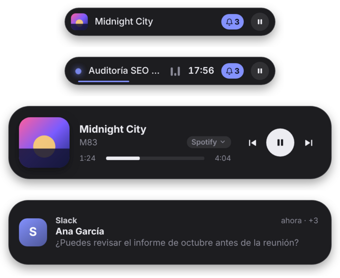
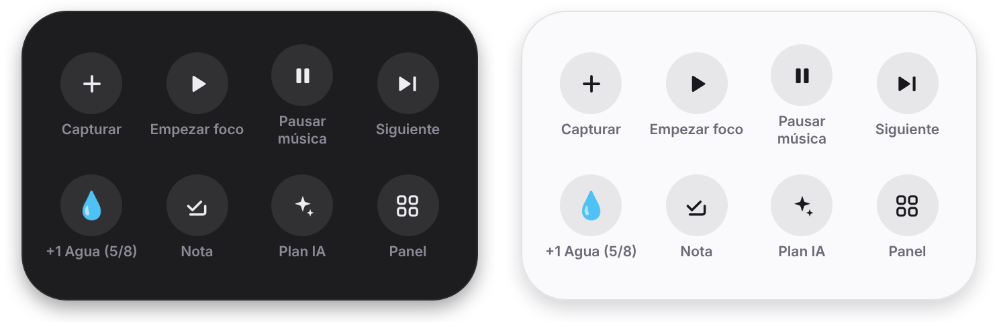
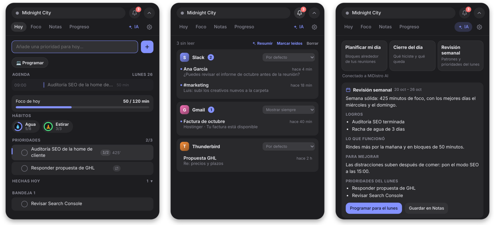

# FocusPill

Píldora flotante de productividad para **Linux y Windows**. Vive arriba en el centro de la pantalla, en todos tus escritorios virtuales, y te dice en qué estás trabajando, cuánto te queda de foco y qué viene en tu agenda.

Desde la v0.3 también es tu **isla dinámica**: muestra la música que suena y la controla sin salir de lo que haces (absorbe a [Islet](https://github.com/anrennnn/Islet-Linux)).

En la v0.4 también recoge tus **avisos**: las notificaciones del sistema y de las webs abiertas (Slack, Gmail, WhatsApp…) asoman en la isla y, durante el foco, se guardan hasta que terminas. *Windows: pendiente, llegará con la versión de Microsoft Store.*

Su IA es la de **tu distro** o un **modelo local** que elijas tú: ningún dato sale de tu equipo salvo hacia los servicios que conectes.







## Qué hace

| Modo | Cómo se abre | Para qué |
|---|---|---|
| **Píldora** | Siempre visible | Tarea actual, temporizador, próxima reunión y botón ▶/‖ |
| **Captura** | `Ctrl+Alt+Espacio` | Apuntar algo sin salir de lo que haces |
| **Herramientas** | Mantener pulsada la píldora, clic derecho o `Ctrl+Alt+H` | Accesos directos como el AssistiveTouch del iPhone |
| **Aviso** | Al llegar una notificación | Quién, de qué app o web y qué dice; clic para abrirla |
| **Música** | Pasar el ratón por la píldora, o solo al cambiar de canción | Carátula, título, progreso con salto y controles |
| **Panel** | Clic en la píldora o `Ctrl+Alt+P` | Hoy, Foco, Notas, Progreso, IA y Ajustes |

**Avisos** (Linux; Windows pendiente)
- Lee las notificaciones del sistema sin sustituir al gestor del escritorio: solo lectura y en tu equipo.
- Reconoce las webs abiertas en el navegador: Slack, Gmail, WhatsApp, Discord, Teams, Outlook, Notion, Linear, GitHub…
- Durante el foco las guarda y, al terminar, te dice cuántas llegaron. Las críticas se muestran siempre.
- Reglas por app o web: por defecto, mostrar siempre, guardar durante el foco o ignorar.
- Vista en el panel agrupada por origen, con resumen por IA (qué atender ya y qué puede esperar). El historial se borra solo.

**Herramientas rápidas**
- Una rejilla de hasta 8 accesos: capturar, foco, música, siguiente canción, +1 al hábito, nota, planificar con IA, primer modo, no molestar, avisos, panel u ocultar.
- Eliges cuáles en Ajustes y qué hace el clic derecho.

**No te quita el teclado**
- La isla se asoma con música, avisos o cambios de foco sin robar el foco de la ventana en la que escribes. Solo lo toma cuando vas a escribir en ella (captura y panel).

**Música (isla dinámica)**
- Funciona con Spotify, VLC, Firefox, Chrome, Rhythmbox y cualquier reproductor con MPRIS en Linux, o con controles multimedia en Windows.
- Elige sola el reproductor que está sonando; también puedes fijar uno en Ajustes.
- En la píldora: carátula, título y ecualizador. Al pasar el ratón: controles, progreso con salto y cambio de reproductor.
- Durante el foco solo se ve un pequeño ecualizador, para no distraer.

**Modos**
- Un botón en Hoy, como «📈 SEO», abre de una vez tus webs y apps de trabajo, cambia el preset de foco y el ambiente, activa «no molestar» y empieza el foco.
- Al salir del modo se restaura todo como estaba.

**Hábitos y agua**
- Hábitos con meta diaria (💧 Agua 8 vasos, 🧘 Estirar…), anillo de progreso y racha.
- Recordatorios en tu horario. Durante el aviso, el botón de la píldora pasa a «+1».

**Hoy**
- Agenda del día con tus calendarios (Google, Outlook, Nextcloud, Proton…) y tus bloques de tiempo.
- Un máximo de 3 prioridades, más bandeja y tareas programadas.
- Subtareas, tareas que se repiten (diaria, laborables, semanal o mensual), arrastrar para ordenar y deshacer al borrar.
- Programar una tarea a una hora: al llegar, el foco empieza solo.
- Importar de Todoist; al completar una tarea en FocusPill, también se completa allí.

**Foco**
- Pomodoro ligado a una tarea, con descansos cortos y largos y presets (25/5, 50/10, 90/15, 15/3).
- «No molestar» automático en GNOME, KDE, XFCE, Cinnamon y MATE.
- Sonido ambiente generado (lluvia, ruido marrón o rosa, olas).
- Aviso si te distraes: si pasas demasiado tiempo en Discord, Steam o similares durante el foco, la píldora te lo recuerda.

**IA** (de tu distro o local)
- **Planificar mi día:** propone bloques de foco alrededor de tus reuniones y los añade a tu agenda.
- **Cierre del día:** resumen de lo hecho, lo pendiente y qué mejorar. Se puede guardar en Notas o enviar a Notion.
- **Clasificar capturas:** decide si lo que apuntas es una tarea, una nota o algo para hoy.
- **Revisión semanal:** patrones, qué mejorar y hasta 3 prioridades para el lunes, que se programan solas. Te la recuerda el día y la hora que elijas.
- **Preguntar:** dudas sobre tu día con el contexto de tus tareas.

**Progreso**
- Foco de hoy, bloques completados, racha y gráfico de 7 días.
- Hábitos de la semana, con los días cumplidos y la racha.
- **Tiempo real por aplicación:** productivo, neutro o distracción. Se cambia la categoría con un clic. Solo se registra el nombre de la app, nunca títulos ni contenido.

**Ajustes**
- Iniciar con el sistema (activado por defecto; se desactiva en Ajustes → Inicio).
- Tema y color de acento.
- Monitor de la píldora.
- Atajos del sistema con un clic (GNOME, Cinnamon, XFCE).
- Exportar e importar datos, y copias diarias automáticas.
- Actualizaciones automáticas.

## Instalar

Descarga la última versión desde **[Releases](https://github.com/anrennnn/pill-linux-windows/releases)**:

| Sistema | Archivo |
|---|---|
| Ubuntu, Debian, Mint, Pop!_OS, elementary | `.deb` → `sudo apt install ./FocusPill_*.deb` |
| Fedora, openSUSE | `.rpm` → `sudo dnf install ./FocusPill-*.rpm` |
| Cualquier distro | `.AppImage` → `chmod +x FocusPill_*.AppImage && ./FocusPill_*.AppImage` |
| Windows 10/11 | `.msi` o `-setup.exe` |

**Descarga directa de la v0.4.0** (mismos archivos que la Release):

- Linux: [FocusPill_0.4.0_amd64.deb](https://github.com/anrennnn/pill-linux-windows/raw/main/releases/FocusPill_0.4.0_amd64.deb) · [FocusPill-0.4.0-1.x86_64.rpm](https://github.com/anrennnn/pill-linux-windows/raw/main/releases/FocusPill-0.4.0-1.x86_64.rpm)
- Windows: [FocusPill_0.4.0_x64-setup.exe](https://github.com/anrennnn/pill-linux-windows/raw/main/releases/FocusPill_0.4.0_x64-setup.exe) · [FocusPill_0.4.0_x64_es-ES.msi](https://github.com/anrennnn/pill-linux-windows/raw/main/releases/FocusPill_0.4.0_x64_es-ES.msi)

> **Windows: avisos pendientes.** La v0.4 de Windows tiene herramientas rápidas, autoarranque y el resto de novedades, pero no lee notificaciones: Windows solo lo permite a apps empaquetadas (MSIX / Microsoft Store). Llegará con esa versión.

Los instaladores de Windows no están firmados con certificado: si aparece «Windows protegió su PC», pulsa «Más información» → «Ejecutar de todos modos». El AppImage, por su tamaño, solo está en Releases.

## IA: de tu distro o local

En **Ajustes → IA** eliges:

- **Mi distro:** si tu distro instala `/etc/xdg/focuspill/ai-provider.json`, FocusPill la detecta y la activa sola. El contrato para desarrolladores de distros está en **[docs/DISTRO-AI.md](docs/DISTRO-AI.md)**.
- **Local o servidor:** cualquier servidor compatible con la API de OpenAI. Hay accesos directos para Ollama, LM Studio, llama.cpp y Jan, y admite `http://` y `unix://`.
- **Ninguna:** todo lo demás funciona igual.

Para probar sin un modelo: `python3 tools/mock-ai-server.py` simula una IA que cumple el contrato.

## Escritorios

- **Todos los escritorios virtuales:** la ventana está siempre encima y no aparece en la barra de tareas ni en Alt+Tab.
- **Clics:** solo la píldora los recibe; el margen transparente deja pasar los clics a lo que haya debajo.
- **Wayland:** la app usa XWayland, porque Wayland no deja a las apps fijar su posición ni quedarse encima. Para probar Wayland nativo: `FOCUSPILL_NATIVE_WAYLAND=1 focuspill`.
- **Atajos en Wayland:** usa **Ajustes → Pantalla y atajos → Crear atajos** (GNOME, Cinnamon o XFCE). En KDE se añaden a mano con los comandos de abajo.
- **Registro de apps:** funciona en X11, XWayland y Windows. Con apps nativas de Wayland no se puede saber cuál está en primer plano.
- **Bandeja del sistema:** en GNOME hace falta la extensión AppIndicator.

## Línea de comandos

```bash
focuspill                 # arranca (si ya está abierta, abre el panel)
focuspill --capture       # captura rápida
focuspill --tools         # herramientas rápidas
focuspill --toggle-focus  # iniciar / pausar foco
focuspill --toggle-panel  # abrir / plegar panel
focuspill --plan          # planificar el día con IA
```

## Datos y privacidad

- Todo se guarda en local: `~/.local/share/com.focuspill.app/` en Linux y `%APPDATA%\com.focuspill.app\` en Windows.
- Los archivos son privados (`0600`) porque guardan los tokens de las integraciones.
- Se hace una copia diaria automática y se conservan 14.
- Los avisos se leen en local y se borran solos (48 h por defecto). FocusPill no responde ni envía nada.
- Los servicios externos solo se contactan si los configuras: calendarios ICS, Todoist, Notion, licencias y actualizaciones.

## Desarrollo

Requisitos: Rust estable, Node 20 o posterior, y en Debian o Ubuntu:

```bash
sudo apt install libwebkit2gtk-4.1-dev libayatana-appindicator3-dev librsvg2-dev libxdo-dev build-essential
npm install
npm test               # tests de la interfaz (lógica, calendario, IA)
npm run test:rust      # tests de Rust (incluye IA por socket Unix)
npm run dev            # modo desarrollo
npm run build:linux    # .deb, .rpm y AppImage
```

Para previsualizar la interfaz en el navegador, sirve `ui/` con `python3 -m http.server` y abre `index.html?mode=panel&tab=ai&plan=1` (añade `&notif=1` para simular un aviso y `&shot=1` para fondo transparente).

Para probar los avisos sin escritorio: `python3 tools/fake_notification_server.py` hace de gestor de notificaciones y `notify-send -a "Google Chrome" Ana "app.slack.com\n\nHola"` simula un mensaje de Slack.

```
ui/js/core.js          lógica pura: fechas, Pomodoro, recurrencias, calendario ICS
ui/js/ai-prompts.js    prompts y validación de respuestas de IA
ui/js/actions.js       tareas, foco, agenda, IA e integraciones
ui/js/views/           vistas del panel
src-tauri/src/         ventana, IA, HTTP/unix, sistema, registro de apps, datos
docs/                  DISTRO-AI.md, RELEASING.md, LICENSING.md
```

Publicar una versión: ver **[docs/RELEASING.md](docs/RELEASING.md)**.
